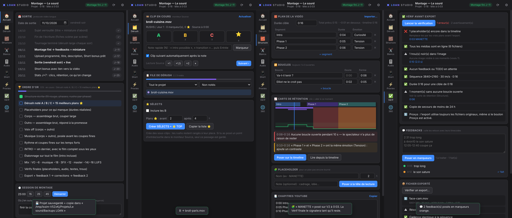
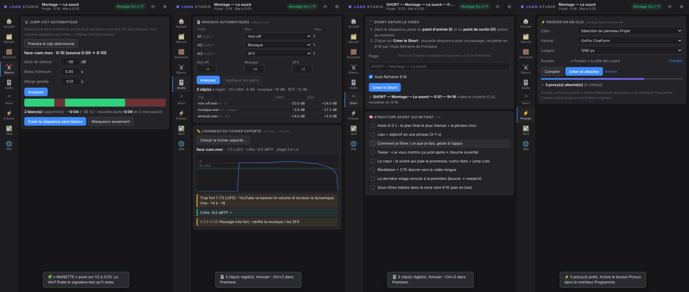
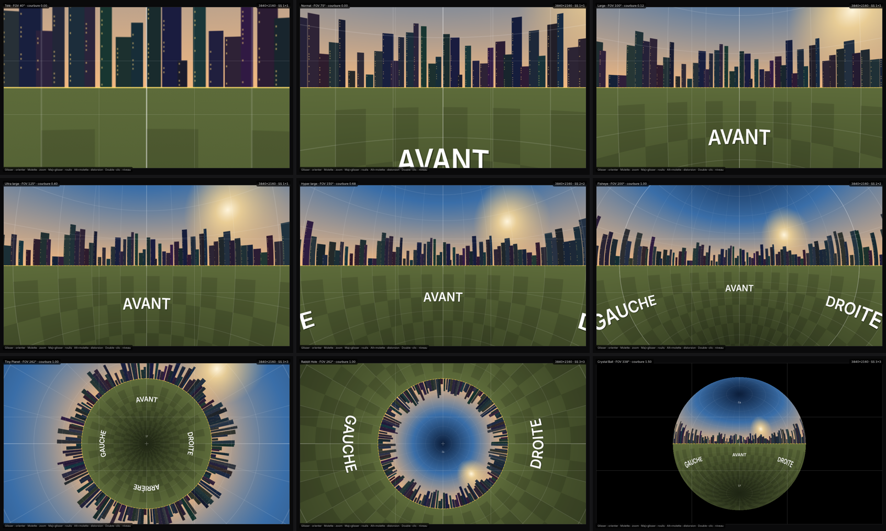

# LOAN Studio — le cockpit de montage pour Premiere Pro (Windows & Mac)

Une extension Premiere Pro taillée pour **tes** vidéos YouTube : elle reprend ta méthode (dérush A/B/C, ordre d'or, boucles, placeholders, mix, feedbacks, Shorts) et automatise ce qui te ralentit. **Reframe 360** est inclus, pour tes vidéos DJI Osmo 360.



| Outil | Ce qu'il fait pour toi |
|---|---|
| 🏠 **Accueil** | Date de sortie → les 8 échéances de ton protocole (montage fini S−7…) avec compte à rebours, ordre d'or coché au fur et à mesure, minuteur de session + note de reprise, sauvegarde + copie de secours en un clic |
| 🗂️ **Dérush** | A/B/C/⭐ au clavier sur le clip du moniteur Source, lecture ×1,5/×2, passage automatique au clip suivant, chutiers SÉLECTS + ⭐ TOP en sous-clips |
| 🧱 **Structure** | Segments + durées cibles + émotions, import Loop Builder, **carte de rétention** (passages sans boucle ouverte, émotions sans contraste), marqueurs `[SEG]`/`[LOOP]` synchronisés avec la timeline, **placeholders**, chapitres YouTube |
| ✂️ **Blancs** | Jump-cut automatique : nouvelle séquence sans les silences (face caméra, voix off) |
| 🎚️ **Audio** | Gains auto par rôle (VO −6, musique −18, SFX −12), loudness EBU R128 de l'export (cible −14/−16 LUFS, crête ≤ −1) |
| 📱 **Short** | Passage I/O → séquence 9:16 avec l'Auto Reframe de Premiere, plus ta structure de Short |
| ⚡ **Proxies** | CineForm / ProRes Proxy créés **et attachés** automatiquement |
| ✅ **Vérif** | Placeholders oubliés, médias hors ligne, trous noirs, feedbacks non traités, durée, rétention, backup ; feedbacks horodatés → marqueurs ; contrôle du fichier exporté |
| 🌐 **Reframe 360** | Recadrage 360 (Télé → Crystal Ball, images clés, 10 bits, Lanczos-3) des vidéos DJI Osmo 360 / Insta360 |



## Installation

👉 **[TUTORIEL-INSTALLATION.md](TUTORIEL-INSTALLATION.md)** : ferme Premiere, double-clique `Install-Windows.bat`, puis **Fenêtre › Extensions › LOAN Studio**.

👉 **Mode d'emploi de chaque outil : [GUIDE-LOAN-STUDIO.md](GUIDE-LOAN-STUDIO.md)**

Il faut **Premiere Pro 2022 ou plus récent** et Windows 10/11 (ou macOS). L'installateur télécharge FFmpeg.

## Reframe 360 en bref



Exporte d'abord tes `.OSV` en vidéo 360 depuis DJI Studio (les `.LRF` ne sont que des aperçus). Ensuite, dans le panneau Reframe 360 : sélectionne le clip, cadre, pose tes clés (**K**), puis clique **RENDU**. Le plan recadré (ProRes 422 HQ 10 bits) est posé au-dessus de l'original, sur une piste libre.

Qualité : reprojection GPU identique à une implémentation de référence à ±1 code sur 1023, et une chaîne décodage → recadrage → encodage qui atteint le plafond du codec (aucune perte ajoutée).

## Pour les développeurs

```
extension/
  CSXS/manifest.xml        2 panneaux CEP : com.loanstudio.studio et com.loanstudio.reframe360
  host/studio.jsx          ExtendScript LOAN Studio (dérush, marqueurs, chutiers, audio, short, proxies, audit, jump-cut)
  host/reframe.jsx         ExtendScript Reframe 360
  shared/js/               pont CEP/Node (host.js) + FFmpeg (décodage 10 bits, silences, loudness, crêtes, placeholders, proxies)
  studio/                  panneau LOAN Studio (core/core.js = logique pure testée, app/*.js = un module par outil)
  reframe/                 panneau Reframe 360 (moteur WebGL2)
tests/
  studio-core / studio-media / studio-host   logique pure, FFmpeg réel, ExtendScript sur un Premiere simulé
  keyframes / render / pipeline / ui         Reframe 360 (shader vs numpy, pipeline au plafond du codec)
  sim/                                       vrais panneaux dans Electron (contexte mixte Node + DOM comme CEP)
                                             + Premiere simulé (premiere-mock.js) exécutant les vrais .jsx
```

- `npm test` : il faut Node 18+, FFmpeg, Python 3 + numpy et Playwright/Chromium.
- `ELECTRON=/chemin/electron xvfb-run npm run test:premiere` : sessions complètes dans les deux panneaux.
